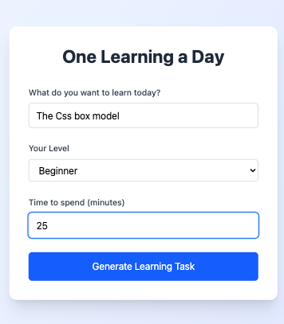
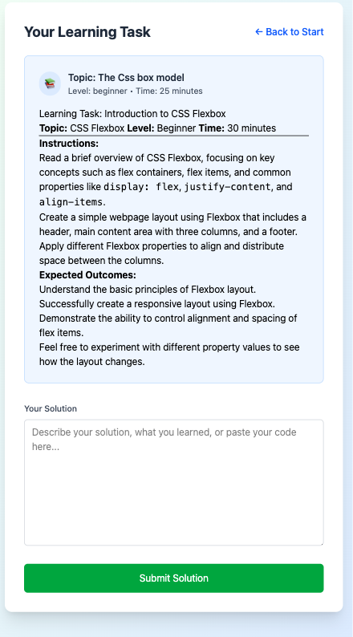
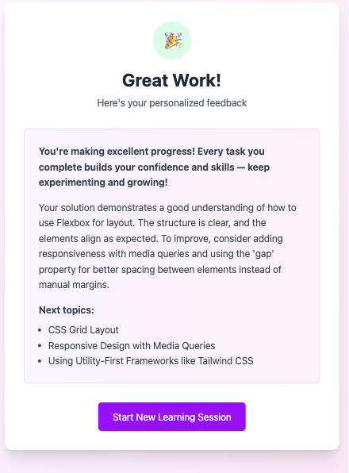

# One Learning a Day

An AI-powered web app that generates personalized learning tasks and provides constructive feedback on your solutions. Designed to help learners focus on a topic every day with manageable, engaging tasks.

---

## 🚀 Features

- Input a learning topic, skill level, and available time  
- Get a tailored learning task generated by OpenAI GPT  
- Submit your solution and receive detailed, encouraging feedback  
- Suggested next steps to continue your learning journey  
- Clean, responsive UI with React and Tailwind CSS  
- Structured JSON feedback for easy integration  

## Visuals





## TO DOs

The app is currently requesting mock data in dev mode
###  Set up
- [ ] add api key for ai connection
- [ ] replace mocked data in task with AI connection in the api
- [ ] replace mocked data in feedback with AI connection in the api

### Roadmap: Features to add
- [ ] Create user accounts
- [ ] Create a learning log for each user
- [ ] Add a calendar view for users to see their daily learning
- [ ] Recap mode: Allow the user to revisit earlier topics and see their responses and feedback
- [ ] Recall mode: Allow users to select topics to practice recall on with quizzes or tasks generated and reviewed by AI. 
- [ ] add payment for users to pay for requests

### Deployment changes

#### Adapt for Vercel 

```
Convert to Vercel serverless format:
``` javascript// api/generate-task.js

import axios from 'axios';

export default async function handler(req, res) {
  if (req.method !== 'POST') {
    return res.status(405).json({ error: 'Method not allowed' });
  }

  try {
    const { topic, level, timeLimit } = req.body;
    // ... rest of your logic
  } catch (error) {
    res.status(500).json({ error: 'Failed to generate learning task' });
  }
}

```
#### Deploy:

``` bashnpm 
install -g vercel
vercel --prod
```
---

## 🛠 Tech Stack

| Layer          | Tools & Libraries                                     |
|----------------|------------------------------------------------------|
| **Frontend**   | React (Vite), Tailwind CSS, React Markdown, validator.js |
| **Backend**    | Vercel Serverless Functions, OpenAI API              |
| **Hosting**    | Vercel                                               |
| **Others**    | Environment variables for API keys, GitHub for version control |

---

## 📁 Project Structure

```plaintext 
my-app/
│
├── public/ # Static assets
├── src/
│ ├── components/ # Reusable React components
│ ├── pages/ # Route-level components (StartPage, TaskPage, etc.)
│ ├── api/ # Helpers to call backend API
│ └── main.jsx # React entry point
│ └── utils/ # validation and mock data
│
├── api/ # Vercel serverless functions
│ ├── generate-task.js # Generate GPT-based learning task
│ └── feedback.js # Generate GPT-based feedback on solutions
│
├── .env# Environment variables (OPENAI_API_KEY, MODE)
├── vite.config.js # Vite config file
├── LICENSE # License file (MIT)
└── README.md # This documentation file
``` 

---

## 🔧 Getting Started

### Prerequisites for usage at the moment

- Node.js (v24 or higher recommended)
- OpenAI API Key ([Sign up here](https://platform.openai.com/account/api-keys))
- Git

### Installation

1. Clone the repo:

   ```bash
   git clone https://github.com/yourusername/one-learning-a-day.git
   cd one-learning-a-day
   ```

1. Install dependencies:


``` bash
  npm install
```
1. Create .env.local file in the root directory and add your OpenAI API key:

``` .env

OPENAI_API_KEY=your_openai_api_key_here

``` 
1. Run the development server:

``` bash
npm run dev
```
Open http://localhost:5173 in your browser.

## 🛠 Usage
On the start page, enter a topic, your skill level, and how much time you want to spend learning.

Submit to generate a tailored task.

Complete the task, then submit your solution on the feedback page.

Receive AI-generated feedback with encouragement and suggestions for next topics.

## ⚙️ Deployment
This app is designed for deployment on Vercel.

1. Push your code to GitHub.

1. Connect the repo to Vercel.

1. Add OPENAI_API_KEY as an environment variable in Vercel settings.

1. Vercel will build and deploy automatically.


## License

This project is licensed under the [MIT]
Copyright (c) 2026 [Nathalie Abendroth Scherf](https://github.com/NathalieScherf/).


Permission is hereby granted, free of charge, to any person obtaining a copy of this software and associated documentation files (the "Software"), to deal in the Software without restriction, including without limitation the rights to use, copy, modify, merge, publish, distribute, sublicense, and/or sell copies of the Software, and to permit persons to whom the Software is furnished to do so, subject to the following conditions:

The above copyright notice and this permission notice shall be included in all copies or substantial portions of the Software.

THE SOFTWARE IS PROVIDED "AS IS", WITHOUT WARRANTY OF ANY KIND, EXPRESS OR IMPLIED, INCLUDING BUT NOT LIMITED TO THE WARRANTIES OF MERCHANTABILITY, FITNESS FOR A PARTICULAR PURPOSE AND NONINFRINGEMENT. IN NO EVENT SHALL THE AUTHORS OR COPYRIGHT HOLDERS BE LIABLE FOR ANY CLAIM, DAMAGES OR OTHER LIABILITY, WHETHER IN AN ACTION OF CONTRACT, TORT OR OTHERWISE, ARISING FROM, OUT OF OR IN CONNECTION WITH THE SOFTWARE OR THE USE OR OTHER DEALINGS IN THE SOFTWARE.

